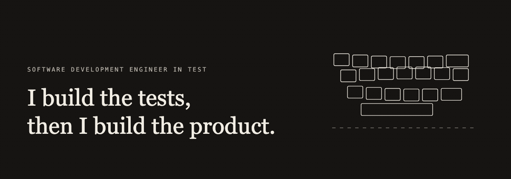

 

[alokkumar.tech](https://alokkumar.tech) · [apps.alokkumar.tech](https://apps.alokkumar.tech) · [LinkedIn](https://www.linkedin.com/in/alokkr016/) · [alokraj016@outlook.com](mailto:alokraj016@outlook.com)

### What I actually do

I write the harness, then I ship the product. Playwright and Selenium for the browser, Appium for phones. The same suite runs on a laptop, across regions, or as an experiment. I also built a visual regression tool, so a layout change is a review instead of a silent drift. Models help aim the tests. A failure still has to be something a person can rerun.

### On the web

| | |
| --- | --- |
| [Namma Metro](https://namma-metro.alokkumar.tech) | Bengaluru’s metro, from today through Phase 3 |
| [Gather](https://gather.alokkumar.tech) | Who owes what |
| [Bridge](https://bridge.alokkumar.tech) | Codes, clipboard, and calls on your own devices |
| [Sift](https://sift-eight-psi.vercel.app) | Keep or discard photos. Nothing leaves the machine |
| [Watchpath](https://watchpath.alokkumar.tech) | A watch order, with a checklist |
| [Panchang](https://panchang.alokkumar.tech) | The day, for where you are |
| [LicenseForge](https://licenseforge.alokkumar.tech) | License keys for indie software |
| [MindVault](https://mindvault-one.vercel.app) | Notes that start on the device |

Now: **SDET at Quince.** Before that, CRED, Cognizant, and a HighRadius internship.
